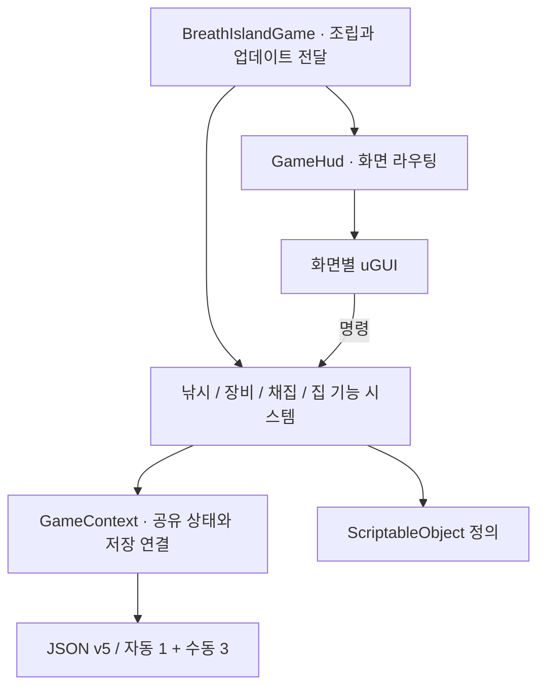

# 숨결섬 — 낚시와 섬 생활을 연결하는 게임

Unity 6 / URP / C# / Windows. 현재 단계는 플레이 가능한 프로토타입이며 출시작이 아니다.

## 대표 플레이

바다에서는 낚은 물고기를 판매·전시·수집하며 시설과 주민 관계를 발전시킨다. 육지에서는 도구를 꺼내 채집하고 가구를 제작해 집에 배치한다. 활동의 결과가 보유 물건과 생활 공간에 남는 흐름을 목표로 한다.

일반 어종 5종·포식자 1종, NPC 2명·시설 2종, 가구 9종과 격자 집 편집을 구현했다. 장기 기획의 구역·콘텐츠 수나 목표 플레이 시간은 현재 구현량이 아니다.

## 대표 화면

| 낚시 | 가방 |
|---|---|
|  |  |
| 채집 안내 | 실내 생활 |
|  |  |

이미지: 2026-10-12 Unity Editor Play Mode, 합성 시연 저장, 1920×1080. 마을·채집·낚시는 촬영 카메라 구도를 사용했다. Windows 입력 검증과 구분한다.

## 역할

역할은 게임 규칙과 범위 결정, UI·공간 디자인 방향 설정, 직접 플레이 검수다. 생활 도구와 무기 직업 분리, 가방 중심 조작, 기본 침대 지급, 이동 속도·채집 횟수·실내 크기 등의 조건을 정했다. 화면 시안을 검토하고 접지·나무 방향·도끼 자세와 동작의 문제를 구체적으로 전달했다.

구현은 Codex · Claude를 활용했다.

## 문제 해결 1 — 위치와 자세를 나누어 검수

**문제:** 캐릭터가 떠 보이고 이동이 막혔으며, 나무가 눕거나 도끼가 옆을 향하고 휘두르기가 작았다.

**판단:** 모델 외형, 지형 충돌, 손 부착과 애니메이션을 서로 다른 문제로 분리했다. 단순히 캐릭터 높이만 낮추면 충돌체나 다른 동작이 깨질 수 있다.

**구현:** 지형의 기본 CapsuleCollider를 표시 표면에 맞는 MeshCollider로 교체했다. FBX 원본 축 보정을 보존하고, 스킨 메시의 실제 형상으로 발 위치를 맞췄다. 손·팔 기준 회전을 사용해 도구 동작의 누적 회전을 막았다.

**근거:** `1860d8a`, `6c062a6`; [ModelPresentation](../Assets/BreathIsland/Runtime/Presentation/ModelPresentation.cs), [ToolSwing](../Assets/BreathIsland/Runtime/Presentation/ToolSwing.cs), [CharacterLocomotionTests](../Assets/BreathIsland/Tests/PlayMode/CharacterLocomotionTests.cs), [WorldMovementTests](../Assets/BreathIsland/Tests/PlayMode/WorldMovementTests.cs).

시연 준비 중 Windows 낚시 화면에서 머리·몸체가 1인칭 카메라를 가리는 현상도 발견했다. FirstPersonBodyView로 플레이어 몸체 표현만 숨기고 탐험 복귀 시 원래 표시 상태를 복원한다. 이동·충돌과 NPC 표현을 끄지 않는 회귀 검사를 추가했다.

## 문제 해결 2 — 가방에서 시작하는 조작

**문제:** 화면마다 도구·장비 조작이 흩어지면 손에 든 물건과 사용 동작을 이해하기 어렵다. 메뉴를 닫은 클릭이 필드 공격으로 이어질 수도 있다.

**판단:** 가방은 기존 아이템 상태를 보여주고 기능 명령을 전달한다. 화면마다 별도 수량을 저장하지 않는다.

**구현:** InventorySystem이 장비·자원·가구를 통합 표시한다. InventoryLayoutSystem은 칸의 ID 순서만 저장한다. 메뉴 진입은 커서와 이동 모드를 전환하며 전환 후 두 프레임 동안 필드 사용 입력을 막는다. 도구 사용은 무기 스킬과 분리한다.

**근거:** `1860d8a`, `6c062a6`; [GamePhaseController](../Assets/BreathIsland/Runtime/Core/GamePhaseController.cs), [InventorySystem](../Assets/BreathIsland/Runtime/Core/InventorySystem.cs), [NotebookUiTests](../Assets/BreathIsland/Tests/PlayMode/NotebookUiTests.cs). 드래그·교환·수량 보존과 네 슬롯 복원, 메뉴 닫기 입력 차단을 검사한다.

## 문제 해결 3 — 집 편집을 저장과 분리

**문제:** 집 크기와 형태를 바꾸는 중에 자원이 차감되거나 기존 가구·출입구를 잃으면 취소와 저장 복원이 불안정해진다.

**판단:** 미리보기와 확정 상태를 분리하고, 적용 시에만 구조와 비용을 함께 변경한다.

**구현:** HomeConstructionSystem이 초안을 편집하고 연결된 바닥, 출입구, 플레이어·가구 영역, 마지막 침대 자리를 검사한다. 취소·화면 전환은 초안을 버린다. v1~v4 저장은 v5로 이전하되 읽기만으로 원본 파일을 덮어쓰지 않는다.

**근거:** `b5c4f92`; [HomeConstructionSystem](../Assets/BreathIsland/Runtime/Housing/HomeConstructionSystem.cs), [SaveMigration](../Assets/BreathIsland/Runtime/Core/SaveMigration.cs), [HomeConstructionTests](../Assets/BreathIsland/Tests/EditMode/HomeConstructionTests.cs), [HomeConstructionLoopTests](../Assets/BreathIsland/Tests/PlayMode/HomeConstructionLoopTests.cs).

## 기술 구조

UI는 저장 수량을 직접 변경하지 않는다. 콘텐츠는 실제 ScriptableObject, 문구는 한국어·영어 Localization 테이블을 사용한다. 모델은 KayKit·Kenney, 서체는 Gaegu·Gowun Dodum을 사용했다. [외부 에셋과 라이선스](../THIRD_PARTY_ASSETS.md)를 별도로 기록했다.

## 실행·시연

[실내 실제 플레이 영상](Portfolio/Video/breath-island-indoor-demo.mp4)은 Windows 실행 화면으로 제작·배치·회전·집 편집·저장 복원을 보여준다(3분 56초). 시연용 저장 데이터를 사용했고, 마지막 구간은 게임을 다시 켜고 불러온 화면이다.

[시연 가이드](Portfolio/DEMO.md)와 [최신 검증 기록](VALIDATION.md)을 함께 제공한다.

Steam 연동, 장시간 플레이 완성도, 저사양 성능 목표와 실제 게임패드는 완료 항목이 아니다. 출시 수준의 완성도는 장기 목표이며 본 포트폴리오의 시연 완료와 구분한다.
